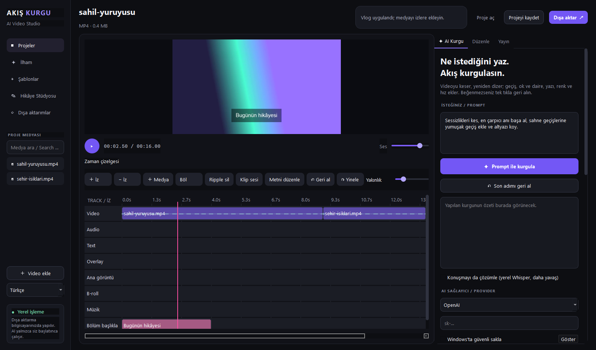
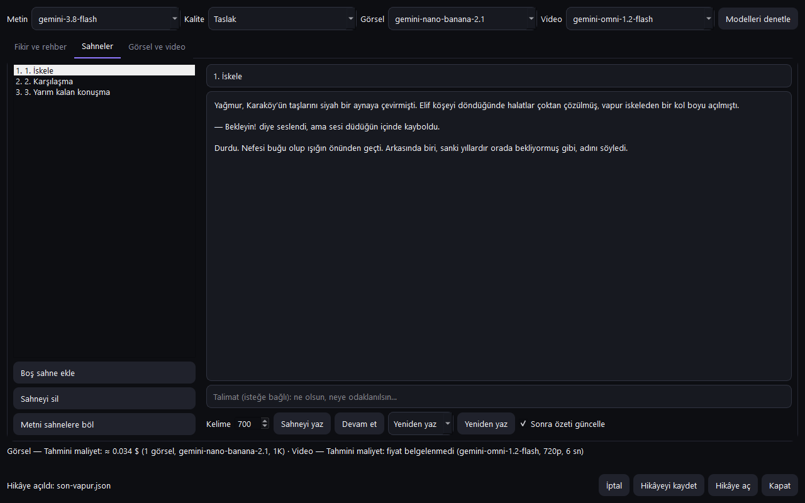
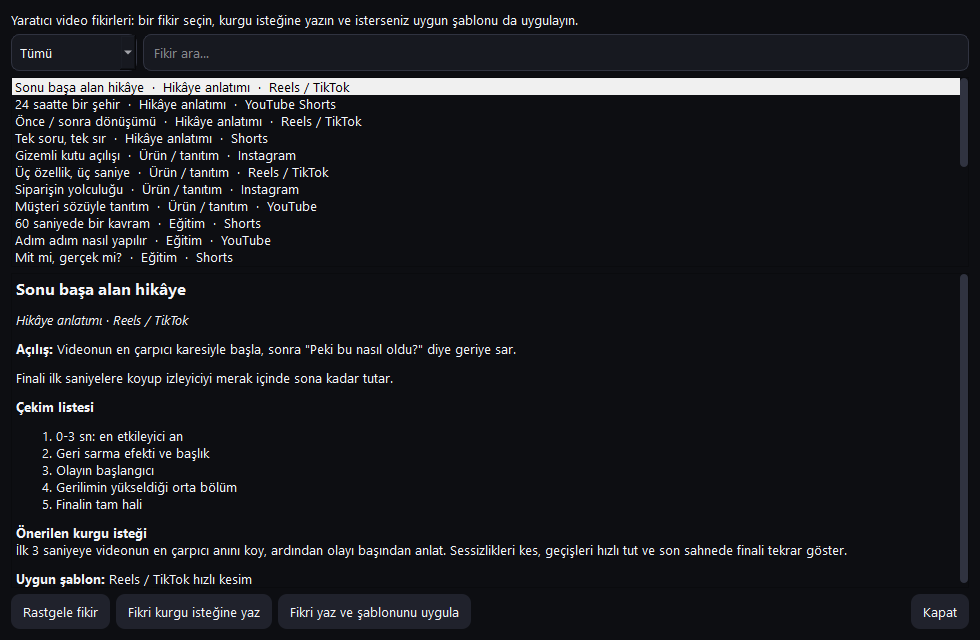

<p align="center"></p>

<p align="center">
  <a href="https://github.com/anilcanolcer/akis-kurgu-ai/releases/latest"></a>
  <a href="https://github.com/anilcanolcer/akis-kurgu-ai/actions/workflows/windows-build.yml"></a>
  <a href="LICENSE"></a>
  
</p>

<p align="center"><b>Ne istediğini yaz, Akış kurgulasın.</b><br>Windows için Türkçe ve İngilizce, çok izli video düzenleyici. Kurgu ve dışa aktarma bilgisayarınızda yapılır; yapay zekâ yalnızca siz başlattığınızda, kendi anahtarınızla çalışır.</p>

<p align="center"><a href="https://github.com/anilcanolcer/akis-kurgu-ai/releases/latest/download/AkisKurguAI-Setup.exe"><b>⬇ Windows kurucusunu indir</b></a></p>



## Öne çıkanlar

| | |
| --- | --- |
| **İstekle kurgu** | "Sessizlikleri kes, en çarpıcı anı başa al, altyazı ekle" yazın; plan uygulanır, beğenmezseniz tek adımda geri alınır. B-roll, başlık ve müzik izleriniz korunur. |
| **Hikâye Stüdyosu** | Gemini ile öncülden hikâye künyesi ve sahneler; sahnenin görseli (Nano Banana) ve kısa videosu (Omni Flash) üretilip zaman çizelgesine eklenir. |
| **Çok izli zaman çizelgesi** | Video, ses, metin ve katman izleri; bölme, kırpma, tüm izleri kaydıran ripple silme, geri al / yinele (Ctrl+Z, Ctrl+Y). |
| **Hızlı önizleme ve dışa aktarma** | Akıcı oynatma için arka planda proxy; H.264/AAC MP4, 4K profilleri, iptal edilebilir ve yarıda kalırsa eski dosyayı bozmayan dışa aktarma. |
| **Altyazı ve seslendirme** | Yerel Whisper ile çevrimdışı konuşma dökümü ve altyazı; Windows sesleriyle metinden seslendirme. |
| **İlham ve Şablonlar** | 23 hazır video fikri (çekim listesi ve kurgu isteğiyle) ve platforma göre iz, oran, renk ve tempo şablonları. |
| **Sağlayıcı seçimi** | OpenAI, Anthropic, xAI, Google Gemini veya Cloudflare Workers AI; anahtarlar Windows Kimlik Bilgileri Yöneticisi'nde saklanır. |
| **Güvenli çalışma** | Otomatik kayıt ve çökme sonrası kurtarma, proje sürümleri, eski sürüme geri dönebilen güvenli güncelleme. |

## Ekran görüntüleri

| Hikâye Stüdyosu | İlham |
| --- | --- |
|  |  |


*Görüntüler uygulamanın gerçek arayüzünden alınmıştır; örnek klipler FFmpeg ile üretilmiş renk geçişleridir, Hikâye Stüdyosu'ndaki metin örnek içeriktir.*

## Kurulum

1. [Kurucuyu indirin](https://github.com/anilcanolcer/akis-kurgu-ai/releases/latest/download/AkisKurguAI-Setup.exe) ve çalıştırın.
2. Başlat menüsünden **Akis Kurgu AI** uygulamasını açın.
3. Yerel Whisper modeli ilk kullanımda indirilir; sonrasında çevrimdışı çalışır.

Kurucu dijital olarak imzalı değildir; Windows veya güvenlik yazılımınız uyarı gösterebilir, kurumsal güvenlik ürünleri kurulumu engelleyebilir. Ayrıntılar ve indirilen dosyayı doğrulama: [docs/kod-imzalama.md](docs/kod-imzalama.md). Uygulama yeni sürümü kendisi önerir; güncelleme sırasında eski sürüm silinmez, bir sorun olursa geri yüklenir.

## Kısa kullanım

1. **Video ekle** ile dosya açın; ilk klip Video izine yerleşir.
2. **AI Kurgu** sekmesinde isteğinizi yazıp **Prompt ile kurgula** deyin ya da klipleri elle düzenleyin: seçin, sürükleyin, **Böl**, **Ripple sil**.
3. **İlham**'dan bir fikir veya **Şablonlar**'dan bir yapı seçerek başlayabilirsiniz.
4. **Düzenle** sekmesinden oran, renk ve hızı ayarlayın.
5. **Dışa aktar** ile MP4 oluşturun; projeyi `.akis.json` olarak kaydedin.

AI özellikleri için AI sekmesinde sağlayıcıyı seçip kendi API anahtarınızı girin. Cloudflare için anahtar `Hesap Kimliği:API anahtarı` biçimindedir. Gemini ile metin, görsel ve video çağrılarının ayrıntıları: [docs/gemini-hikaye.md](docs/gemini-hikaye.md).

### Bilinen sınırlamalar

- Akıcı oynatma, düzenlemeden kısa süre sonra arka planda hazırlanan proxy ile başlar; hazırlanana kadar önizleme kare kare ilerler.
- Hikâye Stüdyosu'nda görsel ve video üretimi Google tarafında ücretli kota gerektirir; ücretsiz katmandaki anahtarlar yalnızca metin üretebilir.
- Yerel Whisper dökümü ve Windows seslendirmesi başladıktan sonra iptal edilemez.
- Keyframe düzenleyici, dışa aktarma kuyruğu ve gelişmiş renk araçları yoktur; İngilizce çeviri eksiksiz değildir.
- Hesap eşitleme veya doğrudan yayınlama sunulmaz.

## Kaynak koddan çalıştırma

Python 3.12, Windows ve PATH üzerinde FFmpeg gerekir:

```powershell
git clone https://github.com/anilcanolcer/akis-kurgu-ai.git
cd akis-kurgu-ai
python -m venv .venv
.\.venv\Scripts\Activate.ps1
python -m pip install -r requirements.txt
python main.py
```

```powershell
# Birim testleri, arayüz etkileşimleri ve gerçek FFmpeg testleri
python -m unittest discover -v
# FFmpeg PATH üzerinde veya AKIS_FFMPEG ile belirtilmişken Windows paketi
python -m PyInstaller AkisKurguAI.spec --noconfirm --clean
```

PyInstaller çıktısı `dist/AkisKurguAI/` klasöründedir. FFmpeg içeren dağıtımlarda ilgili FFmpeg derlemesinin lisans koşulları değerlendirilmelidir.

## Mimari ve katkı

- `akis/timeline_model.py`: kare tabanlı klip ve izler; `akis/frame_plan.py`: etkin katmanlar.
- `akis/timeline_service.py`, `akis/timeline_audio.py`: düzenleme, oynatma saati ve temel ses konumu eşleme.
- `akis/timeline_render.py`, `akis/render_worker.py`, `akis/preview_controller.py`, `akis/media_service.py`: ortak kompozisyon, önizleme iş sırası ve FFmpeg sınırı.
- `akis/multitrack_widget.py`, `main.py`: zaman çizelgesi arayüzü ve uygulama penceresi. Pencerede hâlâ ayrıştırılabilecek iş akışları vardır.
- `akis/project_service.py`: proje şeması ve kayıt; `logo.svg`, `logo.png`, `app.ico`: logo ve simge varlıkları.

Hata bildirirken Windows/Python/FFmpeg sürümlerini ve adımları paylaşın; API anahtarlarını veya kişisel medya dosyalarını depoya eklemeyin. Değişikliklerde mevcut proje dosyalarıyla uyumluluğu koruyun ve testleri çalıştırın.

## Yol haritası

1. **Phase 1:** Timeline ve önizleme/çıktı tutarlılığı, ses ve düzenleme kararlılığı.
2. **Phase 2:** İsteğe bağlı yerel transkripsiyon ve ses araçları.
3. **Phase 3:** Proxy, dışa aktarma ilerlemesi/kuyruğu ve ek görüntü araçları.
4. **Phase 4:** Daha kapsamlı çeviriler, çalışma alanları ve güvenilirlik.

Yol haritası hedefleri mevcut özellik değildir.


Testler `tests/` klasöründedir; uygulama modülleri `akis/` altında bulunur.

Windows kurucusu varsayılan olarak `C:\Program Files\AkisKurguAI` klasörünü kullanır ve yönetici onayı ister. Mevcut kullanıcı klasörü kurulumu otomatik olarak taşınmaz.

## AI planları ve yerel konuşma metni

AI Kurgu panelinde sağlayıcı (OpenAI, Anthropic Claude, xAI Grok veya Google Gemini), model, platform, tempo, stil ve odak seçilerek birden fazla öneri istenebilir. Görsel giriş destekleyen bir model seçin; model alanı düzenlenebilir. Her sağlayıcının anahtarını ayrı girip “Anahtarı güvenli kaydet” ile Windows Credential Manager içinde saklayabilirsiniz. Anahtarlar proje dosyasına yazılmaz. Temsilci kareler seçilen sağlayıcıya gönderilir ve sağlayıcının ücretleri geçerli olabilir. Seçilen öneri zaman çizelgesine başlangıç ve bitiş işaretleri ekler; klipleri otomatik olarak kesmez. API anahtarı gerektirir.

Yerel Türkçe konuşma metni kaynak koddan çalıştırmada isteğe bağlıdır:

```powershell
python -m pip install -r requirements-local-ai.txt
```

Panelde Yerel Whisper ve model boyutunu seçin. İlk kullanımda “Modeli indir” seçeneği internet bağlantısı gerektirir; model indirildikten sonra bu seçeneği kapatarak çevrimdışı kullanabilirsiniz. Yerel sonuç yayın açıklaması alanına aktarılır; “Yerel altyazıyı timeline’a ekle” kaynak zamanlarını mevcut video kliplerine eşleyip yeni bir metin izi oluşturur. Bu klipler ortak önizleme ve dışa aktarmada gösterilir. API transkripsiyonunda OpenAI, xAI veya Gemini ve bunların uygun modeli seçilebilir; sonuç düz metindir. Gemini inline ses sınırı 14 MB ile sınırlıdır. Claude için bu uygulamada transkripsiyon yoktur. Yerel Whisper bağımlılıkları kurucuya dahildir; model ayrıca indirilir. API transkripsiyonu ayrı seçenek olarak kalır.

Timeline cetveli ve klip taşıma, yakın klip kenarlarına sınırlı mesafede yapışır. Kliplerin bitişlerini hareket ettirirken yapışma henüz uygulanmaz. Ses ducking henüz yoktur; Windows sistem sesiyle çevrimdışı WAV oluşturulabilir.

Waveform: ses içeren video ve ses klipleri için arka planda FFmpeg ile hesaplanır; kaynak başına ilk 60 dakika gösterilir. Klip başına sabit ses düzeyi desteklenir; ses zarfı otomasyonu henüz yoktur.


## Kurucu ve ses özellikleri

Windows kurucusu `installer.nsi` ve NSIS ile tek dosyalı `AkisKurguAI-Setup.exe` olarak oluşturulur. Önce `python scripts/generate-nsis-uninstall.py dist/AkisKurguAI dist/uninstall-files.nsh`, ardından `makensis installer.nsi` çalıştırılır. GitHub Actions, paketlenmiş Whisper tanılaması ve sessiz kurulum kontrolünden sonra kurucuyu artefakt olarak yükler. Güncel kurucu Releases sayfasında bulunur.

Klip seçip **Klip sesi** ile ses düzeyi ayarlanabilir. Yerel seslendirme Windows sistem sesini kullanarak çevrimdışı WAV oluşturur; kullanılabilir dil ve sesler Windows kurulumuna bağlıdır. Medya listesindeki arama dosya adlarını filtreler. Timeline waveform en fazla ilk 60 dakikayı önbelleğe alır.

Uygulama açılışta yeni sürümü kontrol eder ve indirdiği kurucunun SHA-256 özetini GitHub sürüm verisiyle karşılaştırır; bu, dijital yayıncı imzası değildir. Uygun olduğunuzda açık projenizi kaydedip güncellemeyi onaylayabilirsiniz; ayarlar ve projeler korunur. Bu özellik için mevcut eski kurucudan bu sürüme bir kez geçmek gerekir.

### İlham / Şablonlar

Sol menüde İlham veya Şablonlar ile sekiz başlangıç düzeninden birini seçin. Kart listesinde önerilen oran, süre, izler ve düzenlenebilir başlık görülür. Stil renk ayarlarını, tempo ise tüm projenin oynatma/dışa aktarma hızını değiştirir. Uygulama mevcut klipleri koruyarak iz ve üç saniyelik başlık ekler; başlık klibini seçip “Metni düzenle” düğmesiyle değiştirebilirsiniz; medyayı izlere kendiniz ekleyin. Boş projede önce şablonu seçip ardından video ekleyebilirsiniz. Önerilen süre otomatik kesme yapmaz. Slideshow için bu sürümün desteklediği video dosyalarını kullanın. Şablonlar genel kurgu fikirlerinden esinlenen özgün tanımlardır; üçüncü taraf varlık içermez.

## Lisans

Akış Kurgu AI, [GNU General Public License v3.0](LICENSE) ile yayımlanan özgür bir yazılımdır. Kurulum paketine eklenen FFmpeg, kendi lisansı (GPL) ile ayrı bir program olarak dağıtılır; diğer bağımlılıklar (PySide6/Qt — LGPL, faster-whisper ve diğerleri) kendi açık kaynak lisanslarını taşır.

## Gizlilik / Privacy policy

Uygulama hesap gerektirmez, telemetri veya kullanım istatistiği toplamaz ve projelerinizi hiçbir yere göndermez. Ağ bağlantısı yalnızca şu durumlarda kurulur:

- **Güncelleme denetimi:** açılışta GitHub'ın sürüm bilgisi okunur (`api.github.com`). Bu istekte size ait veri gönderilmez; indirme ve kurulum yalnızca siz onaylarsanız yapılır.
- **AI özellikleri:** yalnızca siz kendi API anahtarınızı girip bir AI işlemi başlattığınızda, seçtiğiniz sağlayıcıya (OpenAI, Anthropic, xAI, Google Gemini veya Cloudflare Workers AI) isteğiniz, videodan seçilen kareler ve varsa konuşma dökümü gönderilir. Bu veriler ilgili sağlayıcının gizlilik koşullarına tabidir. API anahtarları Windows Kimlik Bilgileri Yöneticisi'nde saklanır.
- **Yerel Whisper modeli:** "Modeli indir" seçeneğini işaretlediğinizde model dosyaları Hugging Face üzerinden indirilir.

Bunların dışında uygulama, kullanıcı ya da uygulamayı kuran kişi özellikle istemedikçe başka sistemlere bilgi aktarmaz. Kaldırmak için Windows "Uygulamalar" listesindeki **Akis Kurgu AI** girdisini veya kurulum klasöründeki `Uninstall-Akis.exe` dosyasını kullanın.

## Kod imzalama politikası / Code signing policy

Sürümler şu anda dijital olarak imzalı değildir. Açık kaynak projeler için ücretsiz kod imzalama sağlayan SignPath Foundation'a başvuru hazırlanmaktadır; onaylandığında bu bölüm şu ifadeyle güncellenecektir: *Free code signing provided by [SignPath.io](https://about.signpath.io), certificate by [SignPath Foundation](https://signpath.org).*

- **Derleme:** yayımlanan tüm dosyalar, bu depodaki kaynak koddan GitHub Actions üzerinde (`.github/workflows/windows-build.yml`) GitHub'ın barındırdığı makinelerde derlenir.
- **Committers and reviewers:** [@anilcanolcer](https://github.com/anilcanolcer)
- **Approvers:** [@anilcanolcer](https://github.com/anilcanolcer)
- Her sürümün kurucusunun SHA-256 değeri sürüm sayfasında yer alır; ayrıntılar: [docs/kod-imzalama.md](docs/kod-imzalama.md).
