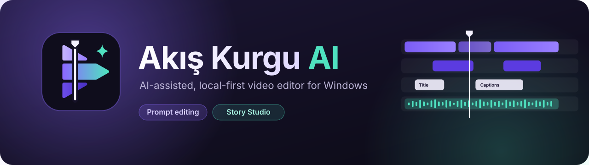
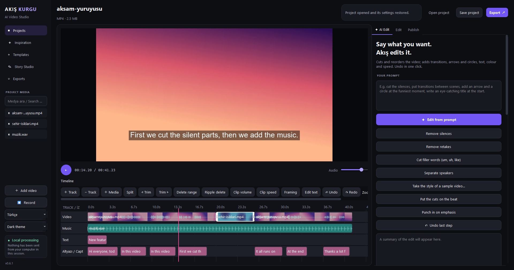
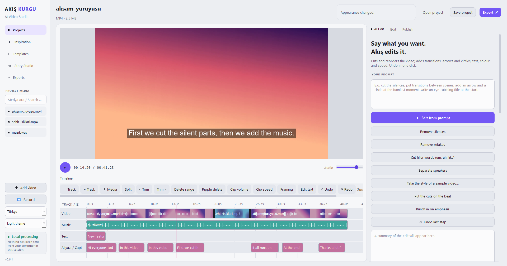
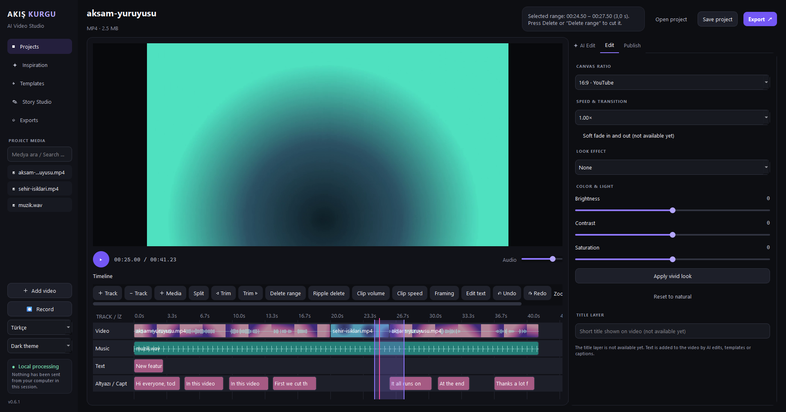
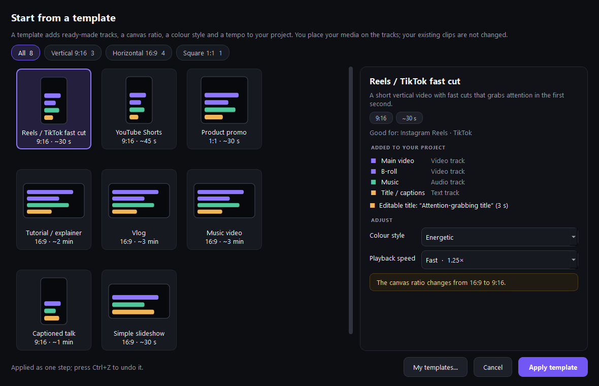
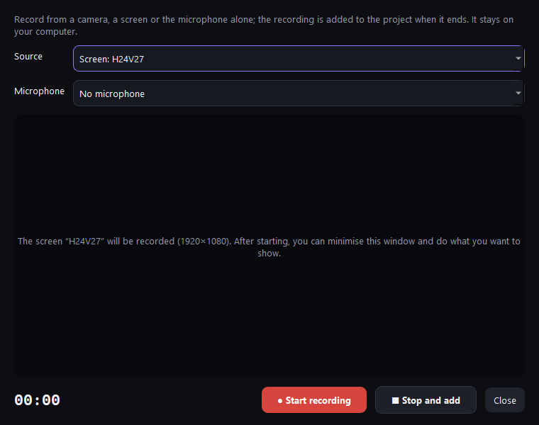
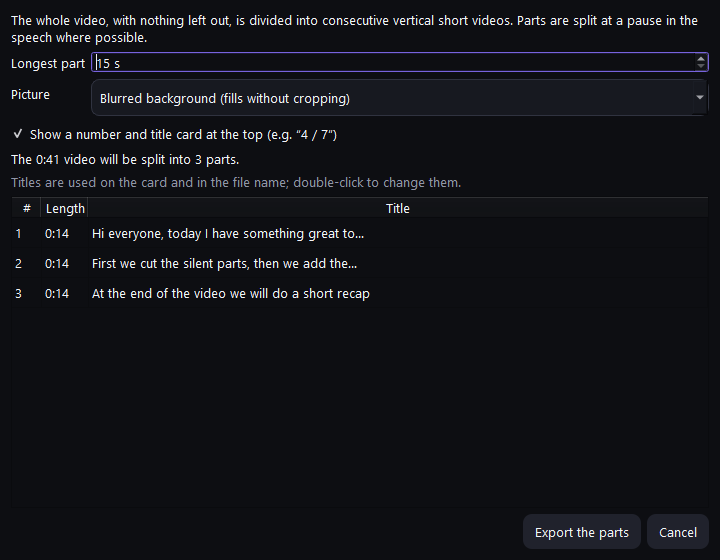
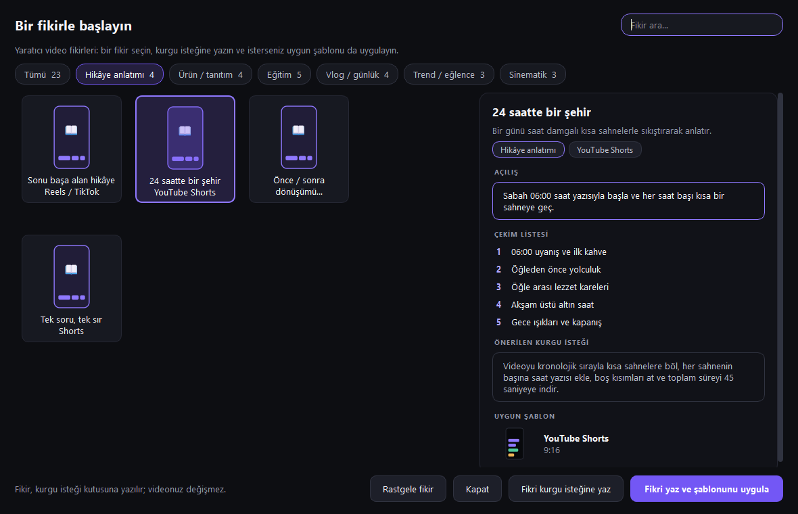

<p align="center"></p>

<p align="center">
  <a href="https://github.com/anilcanolcer/akis-kurgu-ai/releases/latest"></a>
  <a href="https://github.com/anilcanolcer/akis-kurgu-ai/actions/workflows/windows-build.yml"></a>
  <a href="LICENSE"></a>
  
  
</p>

<p align="center">
  <b>Say what you want. Akış edits it.</b><br>
  A multi-track video editor for Windows with a Turkish and English interface. Editing, captions and export run on your own computer; AI features run only when you start them, with your own API key.
</p>

<p align="center">
  <a href="https://github.com/anilcanolcer/akis-kurgu-ai/releases/latest/download/AkisKurguAI-Setup.exe"><b>⬇ Download the Windows installer</b></a>
  &nbsp;·&nbsp;
  <a href="README.tr.md">🇹🇷 Türkçe</a>
</p>



## Contents

- [Why Akış Kurgu](#why-akış-kurgu)
- [Features](#features)
- [Screenshots](#screenshots)
- [Installation](#installation)
- [Getting started](#getting-started)
- [Keyboard shortcuts](#keyboard-shortcuts)
- [AI providers and keys](#ai-providers-and-keys)
- [Known limitations](#known-limitations)
- [Building from source](#building-from-source)
- [Project structure](#project-structure)
- [Contributing](#contributing)
- [Privacy policy](#privacy-policy)
- [Code signing policy](#code-signing-policy)
- [License](#license)

## Why Akış Kurgu

Talking-head videos, tutorials, vlogs and Shorts take hours of repetitive work: cutting pauses and retakes, writing captions, reframing for vertical video, exporting several versions. Akış Kurgu does that work in a few clicks, and does most of it **without the internet or an AI account**.

- **Local first.** Silence and retake removal, filler-word cuts, speaker separation, captions (Whisper) and export all run on your PC. The sidebar shows what, if anything, has left your computer in this session.
- **Prompt editing when you want it.** Type a request such as *"cut the silences, put the most striking moment first, add captions"*; the plan can be reviewed before it is applied and is undone in one step.
- **A real timeline.** Video, audio, text and caption tracks; split, trim, ripple delete, range delete, undo and redo.
- **Free and open source** under GPL-3.0.

## Features

### Automatic editing tools

| Tool | What it does |
| --- | --- |
| **Remove silences** | Cuts the parts with no speech, without AI or internet. Shows how much shorter the video gets before anything changes. |
| **Remove retakes** | When the same sentence was said several times, only the last attempt stays. |
| **Cut filler words** | Finds and cuts hesitations such as "um", "uh" and their Turkish equivalents ("ııı", "eee", "şey"). |
| **Separate speakers** | Marks speaker changes in interviews and conversations, or keeps a single speaker. Uses a small bundled voice model (WeSpeaker, CC BY 4.0). |
| **Take the style of a sample video** | Measures a video you like (aspect ratio, framing, loudness, colour, tempo) and saves it as a template you can apply. |
| **Cuts on the beat / punch-in on emphasis** | Moves cuts onto the music's beats; zooms in where the speaker's voice rises. |
| **Highlights and Shorts** | Splits the best moments, or the whole edit, into vertical Shorts with a blurred background, a part number and a title card. |
| **Prompt editing** | Cuts, reorders, adds transitions, arrows and circles, text, colour and speed from a written request, with an optional step-by-step plan review. |

### Timeline and manual editing

- Multi-track timeline with video, audio, text and caption tracks; clips snap to nearby edges and can be dragged between tracks.
- **CapCut-style trimming:** trim handles on the selected clip, trim to the playhead (**Q** / **W**), and select any range by dragging on an empty spot to delete it from every track at once.
- Split, ripple delete, per-clip volume and **clip speed** (captions follow the new speed), framing (fit, fill, blurred background).
- Waveforms and video thumbnails on clips; frame-accurate seeking; unlimited undo / redo.

### Captions, audio and voice-over

- Offline transcription with **local Whisper**; selectable speech language and a glossary of names and terms.
- Caption looks including **word-by-word captions** with the spoken word highlighted. Captions are placed and split to fit the picture.
- Loudness normalisation (−14 LUFS), noise reduction and automatic music ducking under speech.
- Text-to-speech voice-over with the voices installed in Windows, placed straight onto the timeline.

### Recording

- **Record** from a camera, a screen or a microphone, with or without a microphone track. The recording is added to the project when it ends: video joins the timeline, sound lands at the playhead as a voice-over.

### Export

- H.264 / AAC MP4 up to 4K, with progress and remaining time. Exports can be cancelled, and a failed export never damages an existing file.
- One edit to **vertical, square and horizontal** in a single run; **batch export** for several videos with the same settings.
- **Fast export** without re-encoding when the edit is made of cuts only.
- **FCPXML** export for DaVinci Resolve and Final Cut Pro.
- Before exporting, the timeline is checked for surprises (stretches with no picture, text or sound running past the video) and free disk space is checked.

### Ideas, templates and Story Studio

- **Inspiration:** 23 video ideas, each with an opening line, a shot list, a ready edit request and a matching template.
- **Templates:** eight starting layouts (Reels / TikTok, YouTube Shorts, tutorial, vlog, music video…) that add tracks, aspect ratio, colour style and tempo. Save your own project as a template.
- **Story Studio (Gemini):** turns a premise into a story outline and scenes, then generates an image or a short video per scene and adds it to the timeline.

### Comfort and safety

- Dark and light themes; Turkish and English interface.
- Autosave and crash recovery, project snapshots.
- In-app updates that verify the installer's SHA-256 checksum and restore the previous version if anything fails.
- Proxy files in the background for smooth playback, chunked preview rendering for long edits, HDR (PQ/HLG) sources tone-mapped to SDR.

## Screenshots

| Light theme | Range selection and the Edit tab |
| --- | --- |
|  |  |
| **Templates** | **Record** |
|  |  |
| **Split into Shorts** | **Inspiration** (idea texts are in Turkish) |
|  |  |

*Screenshots are taken from the real application (version 0.6.1). The sample clips are colour gradients generated with FFmpeg and the speech is a Windows text-to-speech voice.*

## Installation

**Requirements:** Windows 10 or 11 (64-bit). FFmpeg and everything else the app needs are included in the installer.

1. [Download the installer](https://github.com/anilcanolcer/akis-kurgu-ai/releases/latest/download/AkisKurguAI-Setup.exe) and run it.
2. Open **Akis Kurgu AI** from the Start menu (optionally from a desktop shortcut).
3. The local Whisper model is downloaded the first time you transcribe; after that, transcription works offline.

The installer is **not digitally signed yet**, so Windows SmartScreen or your security software may show a warning, and some corporate security products may block it. How to verify the download: [docs/kod-imzalama.md](docs/kod-imzalama.md).

**Updates:** the app checks GitHub for a new version at startup and asks before downloading. The downloaded installer is checked against the SHA-256 checksum published with the release, the old version is kept until the new one is fully written, and settings and projects are preserved.

**Uninstall:** use **Akis Kurgu AI** in Windows *Apps*, or `Uninstall-Akis.exe` in the installation folder.

## Getting started

1. **Add video** (or drag a file onto the window). The first clip goes onto the Video track.
2. Use the one-click tools in the **AI Edit** tab (*Remove silences*, *Remove retakes*, *Cut filler words*…) or edit by hand: select, drag, **Split**, trim with **Q** / **W**, select a range and press **Delete**.
3. Transcribe with local Whisper in the **AI Edit** tab, pick a caption look and add the captions to the timeline.
4. Set aspect ratio, colour and speed in the **Edit** tab, or start from **Templates** or **Inspiration**.
5. **Export** an MP4, several formats at once, Shorts, or an FCPXML file. Save the project as `.akis.json`.

## Keyboard shortcuts

Press **F1** in the app for the full list.

| Keys | Action |
| --- | --- |
| Space | Play / pause |
| S | Split the selected clip at the playhead |
| Q / W | Remove the part of the selected clip before / after the playhead |
| Delete | Delete the selected range or clip |
| Esc | Clear the selected range |
| ← / → | One frame back / forward |
| Shift + ← / → | One second back / forward |
| Home / End | Go to the start / end |
| Ctrl + Z / Ctrl + Y | Undo / redo |
| Ctrl + I | Add video |
| Ctrl + O / Ctrl + S | Open / save project |
| Ctrl + E | Export the video |

## AI providers and keys

AI features are optional. Choose a provider in the AI tab and enter **your own API key**:

| Provider | Prompt editing and suggestions | Transcription by API | Story Studio |
| --- | :---: | :---: | :---: |
| OpenAI | ✓ | ✓ | |
| Anthropic Claude | ✓ | | |
| xAI Grok | ✓ | ✓ | |
| Google Gemini | ✓ | ✓ | ✓ |
| Cloudflare Workers AI | ✓ | | |

- Keys are stored in the **Windows Credential Manager**, never in project files.
- Selected frames of your video (and the transcript, when there is one) are sent only to the provider you chose, only when you start an AI action. That provider's pricing and privacy terms apply.
- Cloudflare keys use the form `Account ID:API token`.
- Image and video generation in Story Studio needs a paid Google quota; free-tier keys can generate text only. Details: [docs/gemini-hikaye.md](docs/gemini-hikaye.md).

## Known limitations

- Windows only; macOS and Linux are not supported.
- Smooth playback starts once the background proxy is ready; until then the preview steps frame by frame.
- A local Whisper transcription or Windows voice-over cannot be cancelled once started.
- No keyframe editor, export queue or advanced colour grading yet.
- The interface is translated into English, but the texts of the Inspiration ideas are Turkish only.
- No account sync or direct publishing to social platforms.

## Building from source

You need Windows, **Python 3.12** and **FFmpeg** on `PATH` (or set `AKIS_FFMPEG`).

```powershell
git clone https://github.com/anilcanolcer/akis-kurgu-ai.git
cd akis-kurgu-ai
python -m venv .venv
.\.venv\Scripts\Activate.ps1
python -m pip install -r requirements.txt
python -m pip install -r requirements-local-ai.txt   # local Whisper (optional)
python main.py
```

```powershell
# Tests: units, UI interactions and real FFmpeg renders
python -m unittest discover -s tests

# Windows package (output in dist/AkisKurguAI/)
python -m PyInstaller AkisKurguAI.spec --noconfirm --clean

# Installer
python scripts/generate-nsis-uninstall.py dist/AkisKurguAI dist/uninstall-files.nsh
makensis installer.nsi
```

GitHub Actions runs the tests, starts the packaged app, and checks installing, updating and uninstalling on every push. When the version number changes, it publishes the installer and its checksum file.

## Project structure

| Path | Contents |
| --- | --- |
| `main.py` | Application entry point and the main window |
| `akis/window/` | Window parts: layout, project, playback, timeline editing, AI assistant, export, updates |
| `akis/timeline_model.py`, `akis/timeline_service.py` | Frame-based clips and tracks; editing operations |
| `akis/timeline_render.py`, `akis/render_worker.py`, `akis/media_service.py` | Composition shared by preview and export; the FFmpeg boundary |
| `akis/multitrack_widget.py` | The timeline widget |
| `akis/silence_cut.py`, `retakes.py`, `fillers.py`, `speakers.py`, `beat_sync.py`, `emphasis.py`, `shorts_split.py` | Automatic editing tools |
| `akis/ai_providers.py`, `akis/edit_plan.py`, `akis/story_service.py` | AI providers, prompt edit plans, Story Studio |
| `akis/project_service.py` | Project file format and saving |
| `tests/` | Unit, UI and FFmpeg tests |
| `installer.nsi`, `AkisKurguAI.spec`, `scripts/` | Packaging and installer |

## Contributing

Bug reports and pull requests are welcome.

- When reporting a bug, include your Windows version, the app version and the steps to reproduce it. Never attach API keys or private media.
- Keep existing project files compatible, add tests for new behaviour, and run the test suite before opening a pull request.
- User-facing text is written in Turkish and translated in `akis/i18n.py`; add the English text for anything new.

## Privacy policy

Akış Kurgu AI needs no account, collects no telemetry or usage statistics and never uploads your projects. It connects to the network only in these cases:

- **Update check:** at startup the app reads release information from GitHub (`api.github.com`; if the rate limit is reached, the release page and checksum file on `github.com`). No personal data is sent. Downloading and installing happen only after you confirm.
- **AI features:** only when you enter your own API key and start an AI action, your request, selected frames of the video and the transcript (if any) are sent to the provider you chose (OpenAI, Anthropic, xAI, Google Gemini or Cloudflare Workers AI). This data is subject to that provider's privacy terms. API keys are stored in the Windows Credential Manager.
- **Model downloads:** the local Whisper model is downloaded from Hugging Face when you choose to download it.

Apart from these, the program does not transfer information to other systems unless the user or the person installing it specifically asks for it.

## Code signing policy

Releases are currently not digitally signed. An application to SignPath Foundation, which provides free code signing for open-source projects, is being prepared. Once approved, this section will read: *Free code signing provided by [SignPath.io](https://about.signpath.io), certificate by [SignPath Foundation](https://signpath.org).*

- **Builds:** every published file is built from the source code in this repository by GitHub Actions on GitHub-hosted runners (`.github/workflows/windows-build.yml`).
- **Committers and reviewers:** [@anilcanolcer](https://github.com/anilcanolcer)
- **Approvers:** [@anilcanolcer](https://github.com/anilcanolcer)
- The SHA-256 checksum of each release's installer is published on its release page; details: [docs/kod-imzalama.md](docs/kod-imzalama.md).

## License

Akış Kurgu AI is free software released under the [GNU General Public License v3.0](LICENSE). FFmpeg is bundled as a separate program under its own license (GPL). Other components (PySide6 / Qt under LGPL, faster-whisper, the WeSpeaker model under CC BY 4.0 and others) keep their own licenses; see [THIRD_PARTY_NOTICES.txt](THIRD_PARTY_NOTICES.txt).
