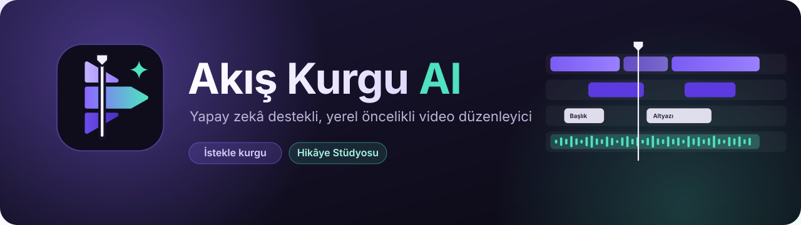
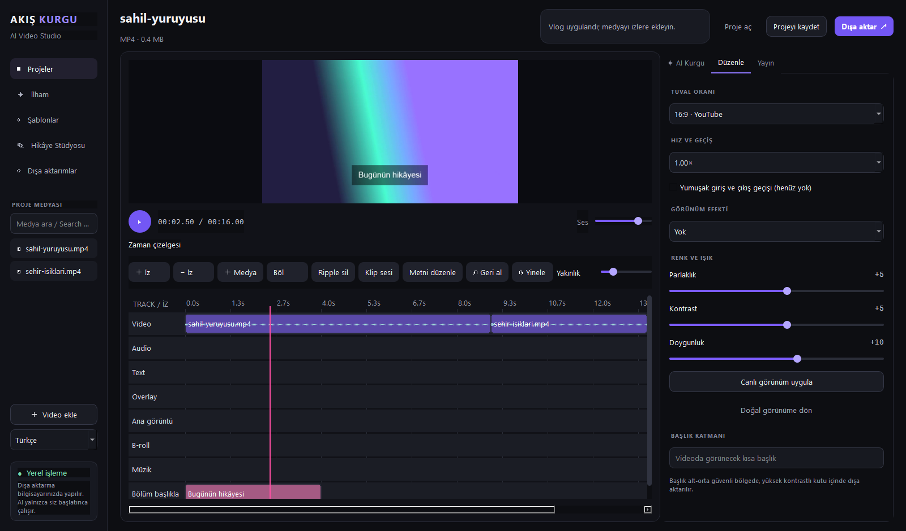

<p align="center"></p>

<h1 align="center">Akış Kurgu AI</h1>
<p align="center">Windows için yerel öncelikli, Türkçe ve İngilizce video düzenleyici</p>

## Windows'ta kurulum

[**Windows kurucusunu indir — AkisKurguAI-Setup.exe**](https://github.com/anilcanolcer/akis-kurgu-ai/releases/download/v0.3.1/AkisKurguAI-Setup.exe)

1. Kurucu EXE dosyasını indirin ve çalıştırın.
2. Kurulum adımlarını tamamlayıp Başlat menüsünden **Akış Kurgu AI** uygulamasını açın.
3. Yerel Whisper modeli ilk kullanımda internet üzerinden indirilir; sonrasında çevrimdışı kullanılabilir.

GitHub Windows ortamında kurulum, açılış ve yerel modelin indirilip çevrimdışı açılması denetlenmiştir; farklı cihazlarda ses eşzamanlaması değişebilir.

## Uygulama görünümü


*Uygulamanın gerçek arayüzü; görüntülerde FFmpeg tarafından oluşturulan örnek test videosu kullanılmıştır.*



*Düzenle sekmesindeki tuval oranı, hız ve renk kontrolleri.*

## Kısa kullanım

1. **Video ekle** ile dosya açın. İlk klip Video izinde görünür.
2. İzdeki klibe tıklayın; cetvel üzerinde tıklayarak veya sürükleyerek oynatma konumunu değiştirin.
3. Klip seçiliyken oynatma çizgisini klibin içine getirin ve **Böl** düğmesine basın. Klipleri aynı izde sürükleyebilir veya **Ripple sil** ile seçileni silip sonraki klipleri kaydırabilirsiniz.
4. Boş bir izi seçip **Medya** ile video/ses ekleyin; **İz** düğmeleriyle izleri yönetin. ▶ düğmesi oynatma ve duraklatma içindir.
5. **Düzenle** sekmesinden oran, renk ve hız ayarlayın; **Dışa aktar** ile MP4 oluşturun. Projeyi `.akis.json` olarak kaydedebilirsiniz.

## Neler çalışıyor?

| Alan | Özellik durumu |
| --- | --- |
| Timeline | Video, ses, metin ve overlay iz modeli; seçim, taşıma, bölme, uçtan kırpma ve ripple silme için temel kontroller |
| Önizleme ve çıktı | Ortak kare planından çok katmanlı FFmpeg kompozisyonu; H.264/AAC MP4, filigransız çıktı ve temel oranlar |
| Renk ve hız | Parlaklık, kontrast, doygunluk ve genel hız önizleme/çıktıya uygulanır; hız değiştirilmiş export ara dosya ve ikinci kodlama kullanır |
| Ses | Tek kaynaklı temel ses önizlemesi ve basit zamanlama düzeltmesi; export tarafında ses izlerinin temel karışımı |
| Proje ve AI | Sürümlü JSON proje; isteğe bağlı OpenAI ile kurgu önerisi ve konuşma metni. API kullanımı internet ve kendi anahtarınızı gerektirir |

### Bilinen sınırlamalar

- Önizleme her kareyi FFmpeg ile üretir; özellikle yüksek çözünürlükte akıcı gerçek zamanlı oynatma beklenmemelidir. Ses önizlemesi tek kaynak seçer, çok izli miksi canlı çalmaz.
- Eski aralık seçici, geçiş, görünüm efekti, başlık alanı ve bazı ses işleme kontrolleri yeni render yoluna bağlı olmadıklarından devre dışıdır. Metin izi model ve render düzeyinde desteklenir; tam bir metin düzenleyicisi yoktur.
- Keyframe düzenleme, proxy, dışa aktarma kuyruğu ve gelişmiş renk araçları yoktur. Çeviriler eksiksiz değildir.
- Instagram müzik kütüphanesi, hesap eşitleme veya doğrudan yayınlama sunulmaz. Proje Instagram ile bağlantılı değildir.

## Kaynak koddan çalıştırma

Python 3.12, Windows ve PATH üzerinde FFmpeg gerekir:

```powershell
git clone https://github.com/anilcanolcer/akis-kurgu-ai.git
cd akis-kurgu-ai
git switch experimental/timeline-render
python -m venv .venv
.\.venv\Scripts\Activate.ps1
python -m pip install -r requirements.txt
python main.py
```

```powershell
# Birim testleri, arayüz etkileşimleri ve gerçek FFmpeg testleri
python -m unittest discover -v
# FFmpeg PATH üzerinde veya AKIS_FFMPEG ile belirtilmişken Windows paketi
python -m PyInstaller AkisKurguAI.spec --noconfirm --clean
```

PyInstaller çıktısı `dist/AkisKurguAI/` klasöründedir. FFmpeg içeren dağıtımlarda ilgili FFmpeg derlemesinin lisans koşulları değerlendirilmelidir.

## Mimari ve katkı

- `timeline_model.py`: kare tabanlı klip ve izler; `frame_plan.py`: etkin katmanlar.
- `timeline_service.py`, `timeline_audio.py`: düzenleme, oynatma saati ve temel ses konumu eşleme.
- `timeline_render.py`, `render_worker.py`, `preview_controller.py`, `media_service.py`: ortak kompozisyon, önizleme iş sırası ve FFmpeg sınırı.
- `multitrack_widget.py`, `main.py`: zaman çizelgesi arayüzü ve uygulama penceresi. Pencerede hâlâ ayrıştırılabilecek iş akışları vardır.
- `project_service.py`: proje şeması ve kayıt; `logo.svg`, `logo.png`, `app.ico`: logo ve simge varlıkları.

Hata bildirirken Windows/Python/FFmpeg sürümlerini ve adımları paylaşın; API anahtarlarını veya kişisel medya dosyalarını depoya eklemeyin. Değişikliklerde mevcut proje dosyalarıyla uyumluluğu koruyun ve testleri çalıştırın.

## Yol haritası

1. **Phase 1:** Timeline ve önizleme/çıktı tutarlılığı, ses ve düzenleme kararlılığı.
2. **Phase 2:** İsteğe bağlı yerel transkripsiyon ve ses araçları.
3. **Phase 3:** Proxy, dışa aktarma ilerlemesi/kuyruğu ve ek görüntü araçları.
4. **Phase 4:** Daha kapsamlı çeviriler, çalışma alanları ve güvenilirlik.

Yol haritası hedefleri mevcut özellik değildir.


## AI planları ve yerel konuşma metni

AI Kurgu panelinde platform, tempo, stil ve odak seçilerek OpenAI üzerinden birden fazla öneri istenebilir. Seçilen öneri zaman çizelgesine başlangıç ve bitiş işaretleri ekler; klipleri otomatik olarak kesmez. API anahtarı gerektirir.

Yerel Türkçe konuşma metni kaynak koddan çalıştırmada isteğe bağlıdır:

```powershell
python -m pip install -r requirements-local-ai.txt
```

Panelde Yerel Whisper ve model boyutunu seçin. İlk kullanımda “Modeli indir” seçeneği internet bağlantısı gerektirir; model indirildikten sonra bu seçeneği kapatarak çevrimdışı kullanabilirsiniz. Yerel sonuç yayın açıklaması alanına aktarılır; “Yerel altyazıyı timeline’a ekle” kaynak zamanlarını mevcut video kliplerine eşleyip yeni bir metin izi oluşturur. Bu klipler ortak önizleme ve dışa aktarmada gösterilir. API seçeneği şimdilik yalnızca düz metin üretir. Yerel Whisper bağımlılıkları kurucuya dahildir; model ayrıca indirilir. API transkripsiyonu ayrı seçenek olarak kalır.

Timeline cetveli ve klip taşıma, yakın klip kenarlarına sınırlı mesafede yapışır. Kliplerin bitişlerini hareket ettirirken yapışma henüz uygulanmaz. Ses ducking henüz yoktur; Windows sistem sesiyle çevrimdışı WAV oluşturulabilir.

Waveform: ses içeren video ve ses klipleri için arka planda FFmpeg ile hesaplanır; kaynak başına ilk 60 dakika gösterilir. Klip başına sabit ses düzeyi desteklenir; ses zarfı otomasyonu henüz yoktur.


## Kurucu ve ses özellikleri

Bu geliştirme dalında `installer.iss`, Inno Setup 6 ile tek dosyalı `AkisKurguAI-Setup.exe` oluşturur. GitHub Actions, paketlenmiş Whisper tanılaması ve sessiz kurulum kontrolünden sonra kurucuyu artefakt olarak yükler. Güncel kurucu Releases sayfasında bulunur.

Klip seçip **Klip sesi** ile ses düzeyi ayarlanabilir. Yerel seslendirme Windows sistem sesini kullanarak çevrimdışı WAV oluşturur; kullanılabilir dil ve sesler Windows kurulumuna bağlıdır. Medya listesindeki arama dosya adlarını filtreler. Timeline waveform en fazla ilk 60 dakikayı önbelleğe alır.

Uygulama açılışta yeni sürümü kontrol eder ve doğrulanmış kurucuyu arka planda indirir. Uygun olduğunuzda açık projenizi kaydedip güncellemeyi onaylayabilirsiniz; ayarlar ve projeler korunur. Bu özellik için mevcut eski kurucudan bu sürüme bir kez geçmek gerekir.
