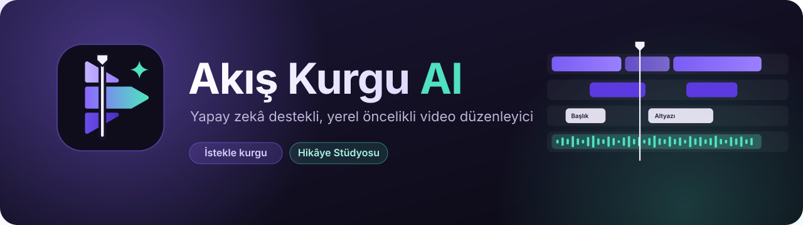
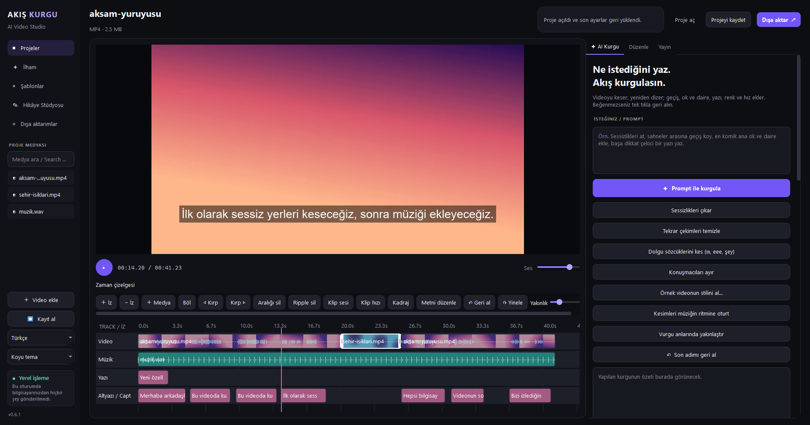
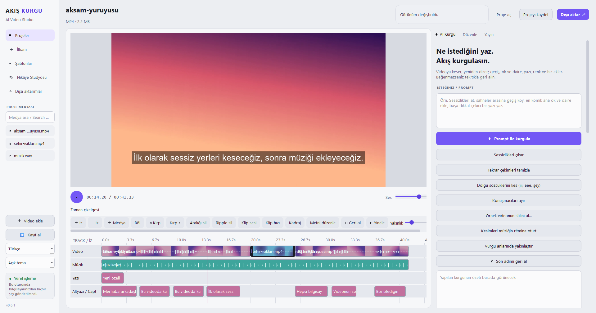
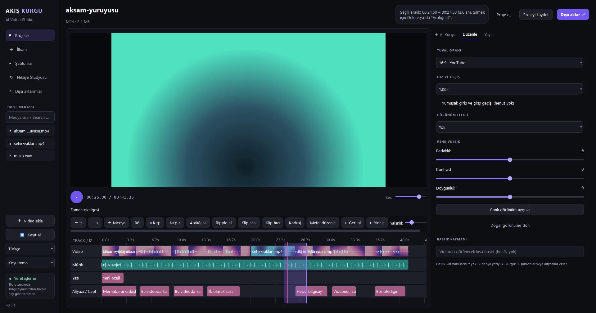
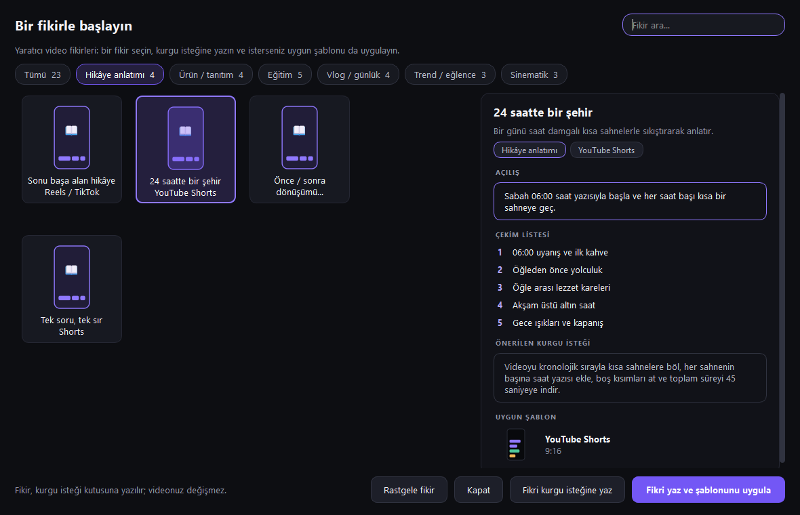
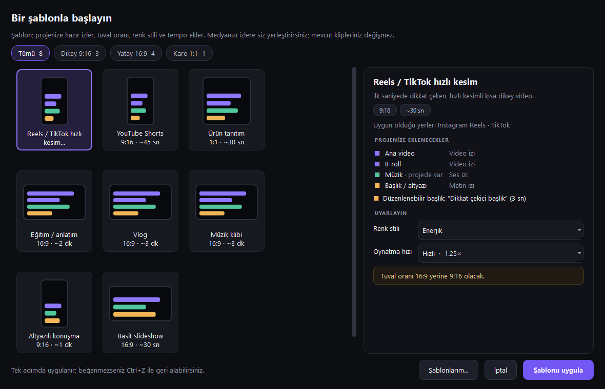
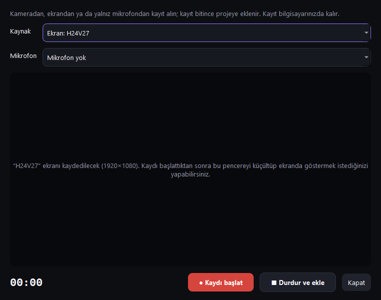
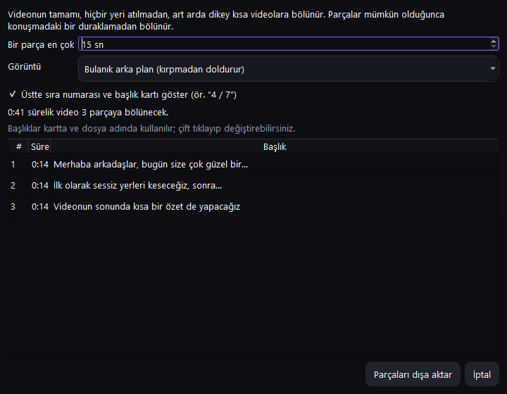

<p align="center"></p>

<p align="center">
  <a href="https://github.com/anilcanolcer/akis-kurgu-ai/releases/latest"></a>
  <a href="https://github.com/anilcanolcer/akis-kurgu-ai/actions/workflows/windows-build.yml"></a>
  <a href="LICENSE"></a>
  
  
</p>

<p align="center">
  <b>Ne istediğini yaz, Akış kurgulasın.</b><br>
  Windows için Türkçe ve İngilizce arayüzlü, çok izli video düzenleyici. Kurgu, altyazı ve dışa aktarma bilgisayarınızda yapılır; yapay zekâ yalnızca siz başlattığınızda, kendi anahtarınızla çalışır.
</p>

<p align="center">
  <a href="https://github.com/anilcanolcer/akis-kurgu-ai/releases/latest/download/AkisKurguAI-Setup.exe"><b>⬇ Windows kurucusunu indir</b></a>
  &nbsp;·&nbsp;
  <a href="README.md">🇬🇧 English</a>
</p>



## İçindekiler

- [Neden Akış Kurgu](#neden-akış-kurgu)
- [Özellikler](#özellikler)
- [Ekran görüntüleri](#ekran-görüntüleri)
- [Kurulum](#kurulum)
- [Hızlı başlangıç](#hızlı-başlangıç)
- [Klavye kısayolları](#klavye-kısayolları)
- [AI sağlayıcıları ve anahtarlar](#ai-sağlayıcıları-ve-anahtarlar)
- [Bilinen sınırlamalar](#bilinen-sınırlamalar)
- [Kaynak koddan derleme](#kaynak-koddan-derleme)
- [Proje yapısı](#proje-yapısı)
- [Katkıda bulunma](#katkıda-bulunma)
- [Gizlilik](#gizlilik)
- [Kod imzalama politikası](#kod-imzalama-politikası)
- [Lisans](#lisans)

## Neden Akış Kurgu

Konuşma videoları, eğitimler, vloglar ve Shorts saatlerce tekrar eden iş ister: duraklamaları ve tekrar çekimleri kesmek, altyazı yazmak, dikey video için kadrajlamak, birkaç sürüm dışa aktarmak. Akış Kurgu bu işleri birkaç tıkla yapar; çoğunu **internet ya da yapay zekâ hesabı olmadan**.

- **Önce yerel.** Sessizlik ve tekrar çekim temizliği, dolgu sözcüklerini kesme, konuşmacı ayırma, altyazı (Whisper) ve dışa aktarma bilgisayarınızda çalışır. Kenar çubuğu, bu oturumda bilgisayarınızdan bir şey gönderildiyse ne olduğunu gösterir.
- **İstediğinizde istekle kurgu.** *"Sessizlikleri kes, en çarpıcı anı başa al, altyazı ekle"* gibi bir istek yazın; plan uygulanmadan önce incelenebilir ve tek adımda geri alınır.
- **Gerçek bir zaman çizelgesi.** Video, ses, yazı ve altyazı izleri; bölme, kırpma, ripple silme, aralık silme, geri al / yinele.
- GPL-3.0 lisanslı, **ücretsiz ve açık kaynak**.

## Özellikler

### Otomatik kurgu araçları

| Araç | Ne yapar |
| --- | --- |
| **Sessizlikleri çıkar** | Konuşma olmayan yerleri yapay zekâ ve internet kullanmadan keser. Videonun ne kadar kısalacağını önceden gösterir. |
| **Tekrar çekimleri temizle** | Aynı cümle birkaç kez söylendiyse yalnızca son deneme kalır. |
| **Dolgu sözcüklerini kes** | "ııı", "eee", "hmm", "şey" gibi duraklama sözcüklerini bulup keser. |
| **Konuşmacıları ayır** | Röportaj ve sohbetlerde konuşmacı değişimlerini işaretler ya da yalnızca bir konuşmacıyı bırakır. Programla gelen küçük bir ses modeli kullanır (WeSpeaker, CC BY 4.0). |
| **Örnek videonun stilini al** | Beğendiğiniz bir videonun oranını, kadrajını, ses düzeyini, rengini ve temposunu ölçer; şablon olarak kaydedip projenize uygular. |
| **Kesimleri ritme oturt / vurguda yakınlaştır** | Kesimleri müziğin vuruşlarına kaydırır; konuşmacının sesinin yükseldiği yerlerde görüntüyü yakınlaştırır. |
| **Öne çıkan anlar ve Shorts** | En canlı bölümleri ya da kurgunun tamamını; bulanık arka planlı, sıra numaralı ve başlık kartlı dikey Shorts videolarına böler. |
| **Prompt ile kurgula** | Yazılı isteğe göre keser, yeniden dizer; geçiş, ok ve daire, yazı, renk ve hız ekler. İsterseniz plan bölüm bölüm gösterilir. |

### Zaman çizelgesi ve elle kurgu

- Video, ses, yazı ve altyazı izli çok izli zaman çizelgesi; klipler yakın kenarlara yapışır ve izler arasında sürüklenebilir.
- **CapCut tarzı kırpma:** seçili klipte kırpma tutamaçları, oynatma çizgisine göre kırpma (**Q** / **W**) ve boş bir yerden sürükleyerek aralık seçip tüm izlerden tek seferde silme.
- Bölme, ripple silme, klip sesi ve **klip hızı** (altyazılar yeni hıza uyar), kadraj (sığdır, doldur, bulanık arka plan).
- Kliplerde dalga biçimi ve kareler; kare hassasiyetinde konumlama; sınırsız geri al / yinele.

### Altyazı, ses ve seslendirme

- **Yerel Whisper** ile çevrimdışı konuşma dökümü; konuşma dili seçimi ve adlar/terimler listesi.
- Söylenen kelimenin vurgulandığı **kelime kelime altyazı** dahil altyazı görünümleri. Altyazılar görüntüye göre yerleşir ve bölünür.
- Ses eşitleme (−14 LUFS), gürültü azaltma ve konuşma sırasında müziği otomatik kısma.
- Windows sesleriyle metinden seslendirme; kayıt doğrudan zaman çizelgesine eklenir.

### Kayıt

- **Kayıt al:** kameradan, ekrandan ya da yalnızca mikrofondan, istenirse mikrofon sesiyle kayıt. Kayıt bitince projeye eklenir: video zaman çizelgesine, ses kaydı oynatma çizgisine seslendirme olarak yerleşir.

### Dışa aktarma

- 4K'ya kadar H.264 / AAC MP4; yüzde ve kalan süre gösterilir. Dışa aktarma iptal edilebilir; yarıda kalırsa var olan dosya bozulmaz.
- Tek kurguyu **dikey, kare ve yatay** olarak tek seferde dışa aktarma; aynı ayarlarla birden çok videoyu **toplu dışa aktarma**.
- Kurgu yalnızca kesimlerden oluşuyorsa yeniden kodlamadan **hızlı dışa aktarma**.
- DaVinci Resolve ve Final Cut Pro için **FCPXML**.
- Dışa aktarmadan önce zaman çizelgesi şaşırtıcı durumlar için (görüntüsüz bölümler, videodan sonra süren yazı ya da ses) ve boş disk alanı için denetlenir.

### İlham, şablonlar ve Hikâye Stüdyosu

- **İlham:** her biri açılış cümlesi, çekim listesi, hazır kurgu isteği ve uygun şablonla gelen 23 video fikri.
- **Şablonlar:** iz, oran, renk stili ve tempo ekleyen sekiz başlangıç düzeni (Reels / TikTok, YouTube Shorts, eğitim, vlog, müzik videosu…). Kendi projenizi de şablon olarak kaydedebilirsiniz.
- **Hikâye Stüdyosu (Gemini):** bir öncülden hikâye künyesi ve sahneler oluşturur; her sahne için görsel ya da kısa video üretip zaman çizelgesine ekler.

### Rahatlık ve güvenlik

- Koyu ve açık tema; Türkçe ve İngilizce arayüz.
- Otomatik kayıt, çökme sonrası kurtarma ve proje sürümleri.
- Uygulama içinden güncelleme: kurucunun SHA-256 özeti doğrulanır, bir sorun olursa eski sürüm geri yüklenir.
- Akıcı oynatma için arka planda proxy, uzun kurgularda parçalı önizleme, HDR (PQ/HLG) kaynaklarda SDR'ye ton eşleme.

## Ekran görüntüleri

| Açık tema | Aralık seçimi ve Düzenle sekmesi |
| --- | --- |
|  |  |
| **İlham** | **Şablonlar** |
|  |  |
| **Kayıt al** | **Shorts'a böl** |
|  |  |

*Görüntüler uygulamanın gerçek arayüzünden alınmıştır (sürüm 0.6.1). Örnek klipler FFmpeg ile üretilmiş renk geçişleridir; konuşma Windows'un metinden seslendirme sesidir.*

## Kurulum

**Gereksinimler:** Windows 10 veya 11 (64 bit). FFmpeg dahil gereken her şey kurucudadır.

1. [Kurucuyu indirin](https://github.com/anilcanolcer/akis-kurgu-ai/releases/latest/download/AkisKurguAI-Setup.exe) ve çalıştırın.
2. Başlat menüsünden (isterseniz masaüstü kısayolundan) **Akis Kurgu AI**'ı açın.
3. Yerel Whisper modeli ilk dökümde indirilir; sonrasında çevrimdışı çalışır.

Kurucu **henüz dijital olarak imzalı değildir**; Windows SmartScreen ya da güvenlik yazılımınız uyarı gösterebilir, kurumsal güvenlik ürünleri kurulumu engelleyebilir. İndirilen dosyayı doğrulama: [docs/kod-imzalama.md](docs/kod-imzalama.md).

**Güncelleme:** uygulama açılışta GitHub'da yeni sürüm olup olmadığına bakar ve indirmeden önce sorar. İndirilen kurucu, sürümle yayımlanan SHA-256 özetiyle karşılaştırılır; eski sürüm, yenisi tamamen yazılana kadar silinmez. Ayarlar ve projeler korunur.

**Kaldırma:** Windows *Uygulamalar* listesindeki **Akis Kurgu AI** girdisini ya da kurulum klasöründeki `Uninstall-Akis.exe` dosyasını kullanın.

## Hızlı başlangıç

1. **Video ekle** ile dosya açın (ya da dosyayı pencereye sürükleyin). İlk klip Video izine yerleşir.
2. **AI Kurgu** sekmesindeki tek tık araçlarını (*Sessizlikleri çıkar*, *Tekrar çekimleri temizle*, *Dolgu sözcüklerini kes*…) kullanın ya da elle düzenleyin: seçin, sürükleyin, **Böl**, **Q** / **W** ile kırpın, bir aralık seçip **Delete**'e basın.
3. **AI Kurgu** sekmesinde yerel Whisper ile dökümü alın, altyazı görünümünü seçin ve altyazıları zaman çizelgesine ekleyin.
4. **Düzenle** sekmesinden oranı, rengi ve hızı ayarlayın ya da **Şablonlar** veya **İlham** ile başlayın.
5. **Dışa aktar** ile MP4, aynı anda birkaç biçim, Shorts ya da FCPXML oluşturun. Projeyi `.akis.json` olarak kaydedin.

## Klavye kısayolları

Tam liste için uygulamada **F1**'e basın.

| Tuş | İşlem |
| --- | --- |
| Boşluk | Oynat / duraklat |
| S | Seçili klibi oynatma çizgisinden böl |
| Q / W | Seçili klibin oynatma çizgisinden önceki / sonraki kısmını at |
| Delete | Seçili aralığı ya da klibi sil |
| Esc | Seçili aralığı bırak |
| ← / → | Bir kare geri / ileri |
| Shift + ← / → | Bir saniye geri / ileri |
| Home / End | Başa / sona git |
| Ctrl + Z / Ctrl + Y | Geri al / yinele |
| Ctrl + I | Video ekle |
| Ctrl + O / Ctrl + S | Proje aç / kaydet |
| Ctrl + E | Videoyu dışa aktar |

## AI sağlayıcıları ve anahtarlar

AI özellikleri isteğe bağlıdır. AI sekmesinde sağlayıcıyı seçip **kendi API anahtarınızı** girin:

| Sağlayıcı | Prompt ile kurgu ve öneriler | API ile döküm | Hikâye Stüdyosu |
| --- | :---: | :---: | :---: |
| OpenAI | ✓ | ✓ | |
| Anthropic Claude | ✓ | | |
| xAI Grok | ✓ | ✓ | |
| Google Gemini | ✓ | ✓ | ✓ |
| Cloudflare Workers AI | ✓ | | |

- Anahtarlar **Windows Kimlik Bilgileri Yöneticisi**'nde saklanır; proje dosyasına yazılmaz.
- Videodan seçilen kareler (ve varsa konuşma dökümü) yalnızca siz bir AI işlemi başlattığınızda, yalnızca seçtiğiniz sağlayıcıya gönderilir. O sağlayıcının ücret ve gizlilik koşulları geçerlidir.
- Cloudflare anahtarı `Hesap Kimliği:API anahtarı` biçimindedir.
- Hikâye Stüdyosu'nda görsel ve video üretimi Google tarafında ücretli kota ister; ücretsiz katman anahtarları yalnızca metin üretebilir. Ayrıntılar: [docs/gemini-hikaye.md](docs/gemini-hikaye.md).

## Bilinen sınırlamalar

- Yalnızca Windows; macOS ve Linux desteklenmez.
- Akıcı oynatma, arka plandaki proxy hazır olunca başlar; o zamana kadar önizleme kare kare ilerler.
- Yerel Whisper dökümü ve Windows seslendirmesi başladıktan sonra iptal edilemez.
- Henüz keyframe düzenleyici, dışa aktarma kuyruğu ve gelişmiş renk araçları yoktur.
- Arayüz İngilizceye çevrilmiştir, ancak İlham fikirlerinin metinleri yalnızca Türkçedir.
- Hesap eşitleme ya da sosyal platformlara doğrudan yayınlama yoktur.

## Kaynak koddan derleme

Windows, **Python 3.12** ve `PATH` üzerinde **FFmpeg** gerekir (ya da `AKIS_FFMPEG` ile belirtin).

```powershell
git clone https://github.com/anilcanolcer/akis-kurgu-ai.git
cd akis-kurgu-ai
python -m venv .venv
.\.venv\Scripts\Activate.ps1
python -m pip install -r requirements.txt
python -m pip install -r requirements-local-ai.txt   # yerel Whisper (isteğe bağlı)
python main.py
```

```powershell
# Testler: birim, arayüz etkileşimleri ve gerçek FFmpeg çıktıları
python -m unittest discover -s tests

# Windows paketi (çıktı: dist/AkisKurguAI/)
python -m PyInstaller AkisKurguAI.spec --noconfirm --clean

# Kurucu
python scripts/generate-nsis-uninstall.py dist/AkisKurguAI dist/uninstall-files.nsh
makensis installer.nsi
```

GitHub Actions her gönderimde testleri çalıştırır, paketlenmiş uygulamayı açar; kurulum, güncelleme ve kaldırmayı denetler. Sürüm numarası değiştiğinde kurucuyu ve özet dosyasını yayımlar.

## Proje yapısı

| Yol | İçerik |
| --- | --- |
| `main.py` | Uygulamanın giriş noktası ve ana pencere |
| `akis/window/` | Pencere bölümleri: yerleşim, proje, oynatma, zaman çizelgesi düzenleme, AI yardımcısı, dışa aktarma, güncelleme |
| `akis/timeline_model.py`, `akis/timeline_service.py` | Kare tabanlı klip ve izler; düzenleme işlemleri |
| `akis/timeline_render.py`, `akis/render_worker.py`, `akis/media_service.py` | Önizleme ve dışa aktarmanın ortak kompozisyonu; FFmpeg sınırı |
| `akis/multitrack_widget.py` | Zaman çizelgesi bileşeni |
| `akis/silence_cut.py`, `retakes.py`, `fillers.py`, `speakers.py`, `beat_sync.py`, `emphasis.py`, `shorts_split.py` | Otomatik kurgu araçları |
| `akis/ai_providers.py`, `akis/edit_plan.py`, `akis/story_service.py` | AI sağlayıcıları, prompt kurgu planları, Hikâye Stüdyosu |
| `akis/project_service.py` | Proje dosyası biçimi ve kayıt |
| `tests/` | Birim, arayüz ve FFmpeg testleri |
| `installer.nsi`, `AkisKurguAI.spec`, `scripts/` | Paketleme ve kurucu |

## Katkıda bulunma

Hata bildirimleri ve pull request'ler memnuniyetle karşılanır.

- Hata bildirirken Windows sürümünü, uygulama sürümünü ve hatayı tekrarlama adımlarını yazın. API anahtarlarını ya da kişisel medya dosyalarını asla eklemeyin.
- Mevcut proje dosyalarıyla uyumluluğu koruyun, yeni davranış için test ekleyin ve pull request açmadan önce testleri çalıştırın.
- Arayüz metinleri Türkçe yazılır ve `akis/i18n.py` içinde İngilizceye çevrilir; yeni her metnin İngilizcesini de ekleyin.

## Gizlilik

Akış Kurgu AI hesap gerektirmez, telemetri ya da kullanım istatistiği toplamaz ve projelerinizi hiçbir yere göndermez. Ağ bağlantısı yalnızca şu durumlarda kurulur:

- **Güncelleme denetimi:** açılışta GitHub'dan sürüm bilgisi okunur (`api.github.com`; istek sınırı dolmuşsa `github.com` üzerindeki sürüm sayfası ve özet dosyası). Size ait veri gönderilmez; indirme ve kurulum yalnızca siz onaylarsanız yapılır.
- **AI özellikleri:** yalnızca kendi API anahtarınızı girip bir AI işlemi başlattığınızda; isteğiniz, videodan seçilen kareler ve varsa konuşma dökümü seçtiğiniz sağlayıcıya (OpenAI, Anthropic, xAI, Google Gemini ya da Cloudflare Workers AI) gönderilir. Bu veriler o sağlayıcının gizlilik koşullarına tabidir. API anahtarları Windows Kimlik Bilgileri Yöneticisi'nde saklanır.
- **Model indirme:** yerel Whisper modeli, indirmeyi seçtiğinizde Hugging Face üzerinden indirilir.

Bunların dışında program, kullanıcı ya da programı kuran kişi özellikle istemedikçe başka sistemlere bilgi aktarmaz.

## Kod imzalama politikası

Sürümler şu anda dijital olarak imzalı değildir. Açık kaynak projelere ücretsiz kod imzalama sağlayan SignPath Foundation'a başvuru hazırlanmaktadır; onaylandığında bu bölüm şu ifadeyle güncellenecektir: *Free code signing provided by [SignPath.io](https://about.signpath.io), certificate by [SignPath Foundation](https://signpath.org).*

- **Derleme:** yayımlanan tüm dosyalar, bu depodaki kaynak koddan GitHub Actions üzerinde, GitHub'ın barındırdığı makinelerde derlenir (`.github/workflows/windows-build.yml`).
- **Committers and reviewers:** [@anilcanolcer](https://github.com/anilcanolcer)
- **Approvers:** [@anilcanolcer](https://github.com/anilcanolcer)
- Her sürümün kurucusunun SHA-256 değeri sürüm sayfasında yer alır; ayrıntılar: [docs/kod-imzalama.md](docs/kod-imzalama.md).

## Lisans

Akış Kurgu AI, [GNU General Public License v3.0](LICENSE) ile yayımlanan özgür bir yazılımdır. FFmpeg, kendi lisansı (GPL) ile ayrı bir program olarak pakete eklenir. Diğer bileşenler (LGPL lisanslı PySide6 / Qt, faster-whisper, CC BY 4.0 lisanslı WeSpeaker modeli ve diğerleri) kendi lisanslarını taşır; bkz. [THIRD_PARTY_NOTICES.txt](THIRD_PARTY_NOTICES.txt).
